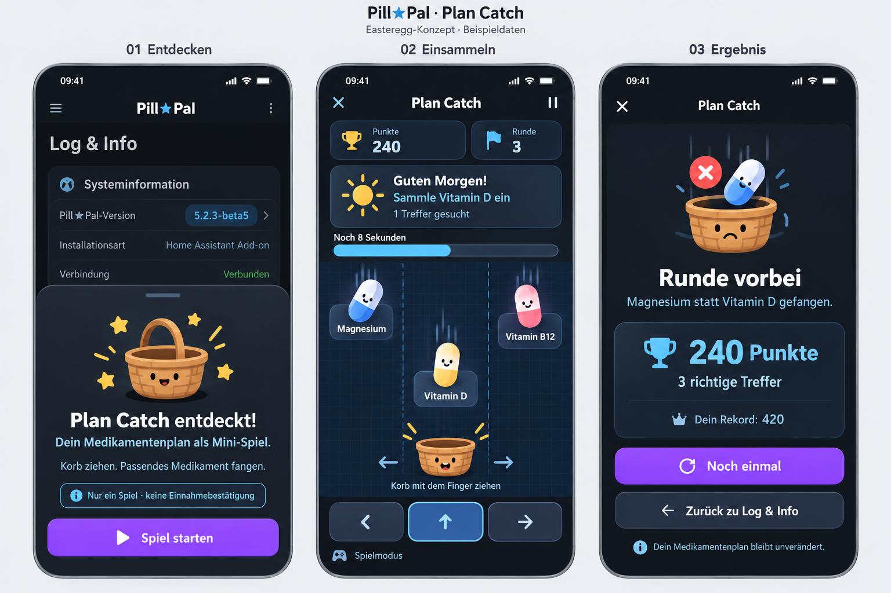
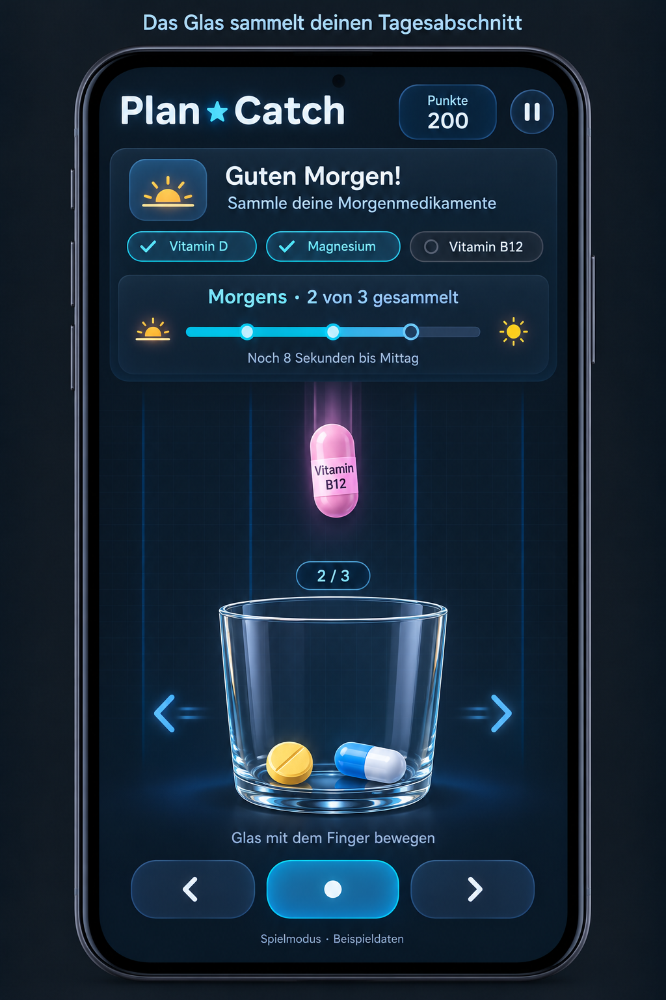

# Pill★Catch – Easteregg-Konzept

Stand: 21. Oktober 2026 · Status: detaillierter Entwurf, noch nicht implementiert.

## 1. Ziel und Grundidee

**Pill★Catch** ist ein verstecktes Mini-Spiel in Pill★Pal. Ein Klick oder Tippen auf die Versionsnummer auf der Seite **Log & Info** öffnet das Spiel. Spielende bewegen ein transparentes Glas und fangen die Medikamente ein, die im ausgewählten Profil für den aktuellen Spiel-Tagesabschnitt vorgesehen sind.

Ein Slot ist ein Tagesabschnitt wie morgens, mittags, abends oder nachts. Pro Slot müssen alle dazugehörigen Medikamente gesammelt werden. Gefangene Medikamente bleiben bis zum Abschluss des Slots sichtbar im Glas. Ein falscher Fang oder ein unvollständiger Slot beim Ablauf der Spielzeit beendet den Durchlauf.

Das Spiel soll auf Smartphones im Hochformat mit einem Finger gut bedienbar sein und zusätzlich Maus und Tastatur unterstützen. Lange Namen und mehr als drei Medikamente pro Slot sind reguläre Anwendungsfälle, keine Sonderfälle.

### Verbindliche Leitentscheidungen

- Anzeigename überall: **Pill★Catch**, mit dem Zeichen `★` zwischen Pill und Catch.
- Das Fanggefäß ist ein transparentes, eher breites und niedriges Glas ohne Flüssigkeit.
- Drei breite Fangspuren; das Glas befindet sich immer auf genau einer Spur.
- Ein benötigtes Medikament entspricht einem Sammelobjekt, unabhängig von der tatsächlichen Dosierung.
- Alle Medikamente eines Slots werden gesammelt, bevor der nächste Slot beginnt.
- Gefangene Objekte bleiben bis zum Slotwechsel im Glas.
- Das Spiel verändert keine Einnahmen, Bestände, Termine oder medizinischen Statistiken.
- Der verwendete Plan wird zum Spielstart als unveränderliche lokale Momentaufnahme übernommen.

## 2. Mockups und ihre Einordnung

Die Bilder sind mit dem integrierten Imagegen-Werkzeug erzeugte Konzeptillustrationen. Sie zeigen keine implementierte Oberfläche. Beide Originalbilder bleiben zur Dokumentation erhalten.

### Früher Ablaufentwurf

Datei: `01-ablauf-mockup.png`

Zeigt die Entdeckung auf der Log-Seite, das Fangspiel und den Ergebnisbildschirm. **Überholt sind der Name „Plan Catch“, der Korb und die Einzelmedikament-Aufgabe.** Maßgeblich sind der Name Pill★Catch, das Glas und die slotweise Sammelmechanik dieses Dokuments. Die dargestellten Systeminformationen sind illustrative Platzhalter und keine technische Beschreibung von Pill★Pal.

### Glas und Slotfortschritt

Datei: `02-glas-mockup.png`

Zeigt die gewünschte Glasidee: Zwei Objekte liegen bereits im Glas, das dritte wird noch benötigt. Häkchen und Zähler machen den Fortschritt sichtbar. Auch hier ist der Bildtitel noch „Plan Catch“; der endgültige Name lautet **Pill★Catch**. Das Glas soll in der Umsetzung etwas niedriger ausfallen, um mehr Reaktionsfläche zu schaffen. Die drei kurzen Namen im Bild sind nur ein Beispiel; die skalierbare Darstellung wird unten festgelegt.

## 3. Einstieg und Navigation

1. Auf **Log & Info** ist die vorhandene Versionsnummer als per Touch und Tastatur bedienbarer Auslöser umgesetzt. Ein einzelner Klick beziehungsweise Tap genügt.
2. Es öffnet sich ein Dialog beziehungsweise auf kleinen Displays eine bildschirmfüllende Spielansicht.
3. Titel: **„Pill★Catch entdeckt!“**
4. Kurzbeschreibung: „Dein Medikamentenplan als Mini-Spiel. Bewege das Glas und sammle alle Medikamente eines Tagesabschnitts.“
5. Dauerhafter Hinweis vor dem Start: **„Nur ein Spiel · keine Einnahmebestätigung“**.
6. Primäraktion: **„Spiel starten“**. Sekundäraktion: **„Zurück“**.
7. Ein kurzes Tutorial zeigt Glasbewegung, gesuchtes Objekt und falsches Objekt; es kann nach dem ersten Mal übersprungen werden.

Die Ansicht respektiert das bestehende Pill★Pal-Theme. Beim Schließen geht der Fokus zurück zur Versionsnummer. Browser-Zurück schließt zunächst die Spielansicht. Beim Verlassen einer laufenden Runde wird diese pausiert; ein Abbruch erfolgt erst über eine klar benannte Aktion.

## 4. Daten aus dem Medikamentenplan

### Auswahl der Spielinhalte

- Grundlage ist das beim Start ausgewählte Profil mit seinen aktiven, regulär geplanten Medikamenten.
- Slotzuordnungen und Anzeigenamen kommen aus dem vorhandenen Plan, nicht aus einer zweiten manuell gepflegten Spielliste.
- Archivierte und reine Bedarfsmedikamente werden nicht als Pflichtobjekte verwendet.
- Ein Medikament, das mehreren Slots zugeordnet ist, darf in jedem dieser Slots einmal gesammelt werden.
- Mehrere Einnahmen desselben Medikaments innerhalb desselben groben Tagesabschnitts werden für das Spiel zu einem Sammelziel zusammengefasst. Das Spiel bildet keine Mengen ab.
- Identität und Trefferprüfung verwenden stabile Medikamenten-IDs, niemals Farbe, Icon oder Namensvergleich allein.
- Bei tagesabhängigen Plänen wird die für das gewählte lokale Datum gültige reguläre Planung verwendet. Der konkrete Adapter ist anhand des vorhandenen Datenmodells zu prüfen.

### Sonderfälle

| Situation | Verhalten |
| --- | --- |
| Slot ohne Medikamente | Wird übersprungen; kurze Übergangsmeldung möglich. |
| Nur ein Medikament im gesamten Spielplan | Neutrale, eindeutig erkennbare Hindernisse liefern die Ablenkung. |
| Kein geeigneter Plan vorhanden | „Demomodus“ mit gekennzeichneten Beispieldaten anbieten. |
| Gleiche Anzeigenamen für verschiedene IDs | Vor dem Start unterscheidbare Zusatzlabels aus vorhandenen eindeutigen Angaben bilden; falls das nicht möglich ist, diese Ziele nicht als gegenseitige Ablenkung einsetzen und den Fall transparent erklären. Keine ununterscheidbaren Fangentscheidungen. |
| Profilwechsel während des Spiels | Spiel pausieren und für einen Neustart mit dem neuen Profil anbieten. Daten nicht vermischen. |
| Planänderung während einer Runde | Aktuelle Momentaufnahme bleibt bis zum Ende gültig; Änderungen gelten beim nächsten Start. |

Die Spielzeit ist fiktiv. „Guten Morgen“ beschreibt den Spielabschnitt und bedeutet nicht, dass gerade real ein Medikament fällig ist.

## 5. Spielablauf

### Beispiel: drei Morgenmedikamente

1. Abschnittskarte: **„Guten Morgen! Sammle deine Morgenmedikamente.“**
2. Bedarf: Vitamin D, Magnesium und Vitamin B12. Zähler zunächst **„0 von 3 gesammelt“**.
3. Benötigte Medikamente und Ablenkungen fallen auf drei Spuren herunter.
4. Das Glas wird auf die Spur des gewünschten Medikaments bewegt.
5. Ein richtiger Fang erzeugt ein kurzes Einspringen ins Glas, markiert das Ziel als erledigt und erhöht die Punkte.
6. Nach zwei Treffern zeigt das Glas zwei Objekte und der Zähler **„Morgens · 2 von 3 gesammelt“**.
7. Beim dritten Treffer stoppt die Fallbewegung sofort. Das Spiel zeigt **„Morgen-Set vollständig!“** und vergibt einen Zeitbonus.
8. Es folgt ein kurzer Tageszeitübergang; das Glas wird geleert und der nächste belegte Slot beginnt.

### Ende eines Durchlaufs

- **Falsches Objekt gefangen:** sofortiges Ende mit konkretem Grund, beispielsweise „Magnesium statt eines noch benötigten Morgenmedikaments gefangen.“
- **Zeit abgelaufen:** Ende mit „Schon Mittag! Dein Morgen-Set war noch nicht vollständig.“ und einer Liste der noch fehlenden Ziele.
- **Nachts abgelaufen:** passende Formulierung „Der nächste Morgen ist da. Dein Nacht-Set war noch nicht vollständig.“
- **Alle belegten Slots geschafft:** Erfolg „Tagesplan komplett gesammelt!“. Danach kann ein weiterer Spieltag mit derselben Momentaufnahme und etwas höherem Schwierigkeitsgrad folgen.

Das Vorbeifallenlassen eines falschen Objekts ist erlaubt. Ein verpasstes richtiges Objekt beendet die Runde nicht sofort; es kann erneut erscheinen, solange Zeit verbleibt. Bereits gefangene Medikamente werden innerhalb des Slots nicht erneut ausgespielt. Noch fallende Duplikate eines gerade gefangenen Ziels werden entfernt, ohne weitere Punkte oder eine Niederlage auszulösen.

## 6. Touch-, Maus- und Tastatursteuerung

### Touch

- Hauptsteuerung: Finger im unteren Steuerbereich horizontal ziehen. Die Position wird auf die nächstgelegene der drei Spuren abgebildet.
- Alternative: auf eine der drei breiten Spurtasten tippen; das Glas springt direkt auf diese Spur.
- Alle drei Tasten wählen absolute Spuren: links, Mitte und rechts. Die mittlere Taste ist keine Sprung- oder Fangaktion.
- Steuerbereich unterhalb des Glases, damit der Finger keine fallenden Namen verdeckt.
- Bedienelemente mindestens 48 × 48 CSS-Pixel, mit genügend Abstand.
- Touch-Gesten verhindern Scrollen nur im eigentlichen Steuerbereich; Medikamentenlisten bleiben normal scrollbar.
- Pointer Capture hält eine begonnene Bewegung stabil. Bei `pointercancel` wird eine aktive Geste sauber beendet.
- Safe-Area-Abstände für Geräte mit Displayaussparung und Home-Indikator berücksichtigen.

### Desktop und alternative Eingabe

- Mausziehen oder Klick auf die Spurtasten.
- Pfeil links/rechts bewegt das Glas jeweils eine Spur; die Tasten 1, 2 und 3 wählen die Spur direkt.
- Leertaste pausiert beziehungsweise setzt fort, solange der Spielfokus aktiv ist.
- Escape öffnet das Pausemenü.
- Sichtbare Fokusmarkierungen und verständliche Beschriftungen aller Aktionen.

## 7. Aufbau der Spielansicht

Von oben nach unten:

1. **Kopfzeile:** Pill★Catch, Punktestand und Pause.
2. **Abschnittskarte:** Tageszeit, Aufgabe, Sammelzähler und Restzeit.
3. **Bedarfsliste:** skalierbare Vorschau noch fehlender Medikamente mit Zugang zur vollständigen Liste.
4. **Spielfeld:** drei Spuren und fallende, beschriftete Objekte.
5. **Glas:** gefangene Objekte bleiben sichtbar; Fortschrittszähler darüber.
6. **Steuerbereich:** drei große Spurtasten, kurze Bedienhilfe beim ersten Start.
7. **Kennzeichnung:** „Spielmodus“.

Die gesamte Ansicht passt in die nutzbare Displayhöhe. Die Seitenhöhe wächst nicht mit der Zahl der Medikamente. Auf kleinen Displays hat das Spielfeld Vorrang vor dekorativen Elementen. Für die aktive Fallstrecke oberhalb des Glases sollen möglichst mindestens 40 % der nutzbaren Höhe erhalten bleiben; ist das nicht erreichbar, werden Bedarfsliste und Kopfbereich weiter verdichtet und das Tempo reduziert. In sehr flachen Ansichten pausiert das Spiel mit einem Hinweis zum Hochformat, statt mit verdecktem Glas weiterzulaufen.

## 8. Lange Medikamentennamen

### Verbindliche Darstellungsregeln

- Schrift wird für lange Namen nicht beliebig verkleinert. Wesentliche Spieltexte bleiben mindestens 16 CSS-Pixel groß, sekundäre Beschriftungen mindestens 14 CSS-Pixel.
- In der vollständigen Bedarfsliste werden Namen vollständig und mehrzeilig angezeigt. Lange Einzelwörter dürfen umbrechen (`overflow-wrap: anywhere`).
- Im kompakten Kopfbereich werden höchstens zwei bis drei Zeilen pro Name verwendet. Eine Kürzung ist nur zulässig, wenn der vollständige Name über eine klar bedienbare Detailansicht erreichbar ist.
- Fallende Objekte tragen ein Textschild; der Name wird nicht auf eine schmale Tablettengrafik gequetscht.
- Wenn der volle Name nicht lesbar in das Textschild passt, erhält das Ziel vor dem Slot eine stabile Kurzkennung wie **M1**, **M2** oder **M12**. Diese erscheint identisch im Textschild und in der Bedarfsliste zusammen mit dem vollständigen Namen.
- Kurzkennungen gelten für den gesamten Durchlauf unverändert. Sie werden nach einem Fang nicht neu vergeben.
- Gleiche Namensanfänge dürfen nicht zu identischen abgekürzten Fangobjekten führen. Die Kurzkennung stellt die Zuordnung sicher.
- Kein laufender Text und keine wesentlichen Informationen ausschließlich per Hover.
- Ein Tippen auf „Alle Medikamente“ pausiert sofort und öffnet die vollständige Liste. So entstehen durch Lesen oder Scrollen keine Spielnachteile.

### Beispiel

| Stelle | Darstellung |
| --- | --- |
| Vollständige Liste | **M4 · Beispielmedikament mit sehr langem Produktnamen und Retardzusatz** – mehrzeilig und vollständig |
| Kompakte Vorschau | **M4 · Beispielmedikament mit …** |
| Fallendes Objekt | **M4** prominent, darunter ein lesbarer Namensauszug auf maximal zwei Zeilen |
| Detailansicht | Vollständiger Name, Status „Noch gesucht“ oder „Gesammelt“ |

Die Kurzkennung ist eine Spielhilfe, keine Abkürzung für eine reale Dosierung. Zusätzliche Medikamentendaten werden nicht erfunden. Enthält der hinterlegte Anzeigename selbst eine Stärke, bleibt diese Bestandteil des Namens; daraus wird keine Spielmenge abgeleitet.

## 9. Mehr als drei Medikamente pro Slot

Die Anzahl der Spuren begrenzt nicht die Anzahl der Sammelziele. Ein Slot darf beispielsweise 4, 8, 12 oder mehr Medikamente enthalten.

### Kopfbereich und Bedarfsliste

- Immer sichtbarer Gesamtzähler, beispielsweise **„Morgens · 7 von 12 gesammelt“**.
- Auf dem Smartphone kompakte Vorschau von höchstens zwei noch fehlenden Zielen und die Schaltfläche **„Alle Medikamente (12)“**.
- Vorschau ist lediglich eine Auswahlhilfe: Alle noch fehlenden Ziele sind fangbar. Es gibt keine heimliche Reihenfolge.
- Die vollständige Liste öffnet pausiert als großflächiger Dialog mit eigenem Scrollbereich. Fehlende Ziele stehen zuerst, gesammelte folgen mit Haken.
- Auf breiten Displays kann die vollständige Liste als Seitenbereich neben dem Spielfeld stehen.
- Kein unendlich wachsender Chip-Stapel über dem Spielfeld und kein seitliches Scrollen als Voraussetzung für das Spielen.

### Viele Objekte im Glas

- Für die ersten acht gesammelten Medikamente werden einzelne symbolische Objekte in zwei bis drei versetzten Lagen sichtbar.
- Ab dem neunten Fang bleiben acht repräsentative Objekte sichtbar. Ein Badge **„+4“** zeigt beispielsweise bei zwölf Fängen die zusätzlich enthaltenen vier Objekte.
- Der Gesamtzähler bleibt immer die maßgebliche exakte Anzeige. Das Glas dient als visuelle Belohnung, nicht als zu entziffernde Bestandsliste.
- Ein neuer Fang erhält auch bei voller Darstellung eine kurze sichtbare Animation; anschließend aktualisieren sich Zähler und Zusatzbadge.
- Tabletten laufen weder über den Glasrand noch verdecken sie Namen, Steuerung oder Restzeit.
- Gefangene Ziele bleiben logisch bis zum Slotende im Glas gespeichert, auch wenn nur ein Teil davon einzeln gezeichnet wird.

### Fairness bei großen Slots

- Zeitbudget wächst mit der Zahl der benötigten Ziele.
- Kein festes Limit von drei Zielen und keine stillschweigende Auswahl nur eines Teils des Plans.
- Jedes benötigte Medikament wird früh genug angeboten und bei Verpassen erneut berücksichtigt.
- Anzahl gleichzeitig fallender Objekte bleibt begrenzt; Schwierigkeit entsteht nicht durch einen unlesbaren Objektteppich.
- Lange Namen und notwendige Lesewege werden bei Tempo und Pausenfunktion berücksichtigt.

## 10. Zeit, Punkte und Schwierigkeit

Folgende Werte sind Startwerte für einen Spieltest, keine bereits validierte Balance:

| Parameter | Vorschlag |
| --- | --- |
| Richtiger Fang | 100 Punkte |
| Erfolgreicher Slot | 10 Punkte je voller verbleibender Sekunde |
| Grundzeit pro Slot | 8 Sekunden plus 6 Sekunden je unterschiedlichem Ziel |
| Beispiele | 1 Ziel: 14 s; 3 Ziele: 26 s; 8 Ziele: 56 s; 12 Ziele: 80 s |
| Gleichzeitig fallende Objekte | Zu Beginn höchstens 2, später höchstens 3; höchstens eines pro Spur |
| Sichtbare Fallzeit | Anfangs ungefähr 4 Sekunden; bei höherer Schwierigkeit nicht unter ungefähr 2,5 Sekunden |
| Steigerung | Pro vollständig gesammeltem Spieltag etwas schneller und geringerer Zusatzpuffer; nicht nach jedem einzelnen Fang |

Das Mindestbudget pro Ziel bleibt erhalten. Eine mögliche spätere Formel ist `8 + Anzahl × max(4, 6 − 0,25 × abgeschlossene Spieltage)` Sekunden. Die Werte müssen an kleinen Displays und mit langen Namen getestet werden. Eine entspannte Einstellung kann das Zeitbudget erhöhen und die Fallgeschwindigkeit reduzieren; Rekorde werden je Modus getrennt geführt.

### Faire Objekterzeugung

- Zunächst jedes fehlende Ziel einmal anbieten, mit bewusst eingeplanten Lücken.
- Danach verpasste und noch fehlende Ziele bevorzugt erneut anbieten.
- Ablenkungen stammen aus anderen Slots des Spielplans oder sind klar erkennbare neutrale Hindernisse.
- Keine Ablenkung darf optisch ununterscheidbar von einem benötigten Ziel sein.
- Keine gleichzeitigen Fangzwänge auf verschiedenen Spuren. Spawn- und Landungsabstände müssen einen erreichbaren Weg für das Glas lassen.
- Wenn das Zeitbudget keine vollständige faire Erstpräsentation aller Ziele erlaubt, wird es vor Slotstart erhöht beziehungsweise das Spawnintervall angepasst.
- Falls eine ungewöhnlich große Zielmenge einen langen Abschnitt ergibt, bleibt die Pause jederzeit verfügbar; Ziele werden nicht entfernt.

Die Sonne beziehungsweise Tageszeit-Leiste zeigt die verbleibende Slotzeit. Sammelfortschritt und Zeitfortschritt sind getrennte Anzeigen. Beim Slotstart erscheint kurz **„Bereit?“**; erst danach starten Fallbewegung und Uhr gleichzeitig.

## 11. Glasdarstellung und Feedback

- Transparentes Glas mit breiter Öffnung, leicht elliptischem Rand und abgerundetem Boden.
- Klare Kontur auch im hellen Theme und bei geringem Kontrast des Hintergrunds.
- Kein Wasser und kein Trinkvorgang: Das Glas ist das Fanggefäß des Spiels.
- Gesammelte Objekte sind stilisierte Symbole, keine verlässliche Abbildung realer Präparate.
- Kurze Einspringanimation bei richtigem Fang; danach ruhende Objekte am Boden.
- Eindeutiger Trefferstatus zusätzlich über Text, Häkchen und Zähler.
- Optional dezente Vibration nach Fang, sofern unterstützt und aktiviert; Ton standardmäßig aus.
- Kein blinkender Alarm oder beschämender Text bei Niederlage.
- Bei reduzierter Bewegung entfallen dekoratives Hüpfen und Übergänge; spielnotwendige Bewegung bleibt nachvollziehbar und kann über den entspannten Modus verlangsamt werden.

Die Kollision wird anhand einer dokumentierten Fangzone an der Glasöffnung berechnet. Die sichtbare Öffnung und die wirksame Fangzone müssen übereinstimmen. Seitliches Berühren des Glasbodens zählt nicht als Fang.

## 12. Pause, Ergebnis und Wiederholung

### Pause

- Manuell über die Kopfzeile oder Tastatur.
- Automatisch bei Wechsel in eine andere App, ausgeblendetem Browser-Tab, Orientierungswechsel oder einer geöffneten Detailansicht.
- Uhr, Objekte und Kollisionen stoppen gemeinsam. Verborgene Zeit wird nicht nachträglich angerechnet.
- Fortsetzen erfolgt bewusst über **„Weiter“** mit kurzer Bereitschaftsphase.
- Pausemenü: Weiter, neu starten, Spiel verlassen.

### Ergebnis

- Titel „Runde vorbei“ oder „Tagesplan komplett gesammelt!“.
- Konkreter Grund bei Niederlage.
- Punkte, Anzahl richtiger Fänge, geschaffte Slots und bisheriger Rekord.
- Bei Zeitablauf vollständige, scrollbar erreichbare Liste der fehlenden Medikamente; lange Namen werden umgebrochen.
- Aktionen **„Noch einmal“** und **„Zurück zu Log & Info“**.
- Hinweis: **„Dein Medikamentenplan bleibt unverändert.“**

Rekorde werden lokal je Profil und Spielmodus gespeichert. Dafür genügt eine profilbezogene Kennung; Medikamentennamen und Planinhalte müssen nicht dauerhaft im Browser gespeichert werden. Falls lokale Speicherung nicht verfügbar ist, bleibt das Spiel nutzbar und zeigt nur den aktuellen Punktestand. Es ist kein Online-Ranking vorgesehen.

## 13. Technische Einbindung in Pill★Pal

### Bestehende Anknüpfungspunkte

- `custom_components/pillpal/frontend/pillpal-panel.js`: Log-Seite wird aktuell durch `_log(profile)` erzeugt; dort befindet sich die Versionsanzeige als Einstieg.
- `custom_components/pillpal/frontend/pillpal.css`: vorhandene Theme-Variablen, Karten und mobile Layoutregeln als gestalterische Grundlage.
- Das Profil stellt bereits Medikamenteninformationen bereit. Die konkrete Ableitung regulärer Slotziele ist gegen die vorhandene Planlogik zu prüfen, bevor ein Datenadapter implementiert wird.

### Empfohlene Umsetzung

- Spielsteuerung und Darstellungslogik als isolierte Frontend-Komponente beziehungsweise klar getrenntes Modul.
- Keine schreibenden Home-Assistant-Aktionen für Fänge, Niederlagen oder Punkte.
- DOM-basierte, zugängliche Steuerung und Bedarfsliste; bewegte Objekte per zeitbasierter Animation aktualisieren.
- Spielschleife mit monotoner Zeitbasis und explizitem Pausenzustand. Geschwindigkeit darf nicht von der Bildwiederholrate abhängen.
- Planbezeichnungen als Text ausgeben, nicht als ungeprüftes HTML.
- Bei Schließen oder Neustart Listener, Animationen und Pointer-Zustand aufräumen.
- Zusätzliche Effekte erst nach funktionierender Touch-Steuerung und skalierbarer Textdarstellung ergänzen.

### Zustandsmodell

`geschlossen → intro → slot-vorbereitung → läuft → slot-erfolg → nächster-slot`

Zusätzliche Übergänge:

- `läuft → pausiert → slot-vorbereitung → läuft` mit bewahrtem Slotzustand und Restzeit.
- `läuft → verloren → ergebnis`.
- `letzter-slot-erfolg → tag-erfolg → nächster-spieltag`.
- `pausiert oder ergebnis → geschlossen`.

Pro laufendem Slot werden mindestens Slotkennung, Ziel-IDs, gesammelte IDs, verbleibende Zeit, Glasposition, aktive Fallobjekte und Punktestand gehalten. Fortschritt ergibt sich aus der Menge gesammelter Ziel-IDs; derselbe Fang darf nicht mehrfach punkten.

Bei gleichzeitigem Fang und Zeitablauf ist die zeitliche Reihenfolge eindeutig zu definieren: Ein gültiger Fang bis einschließlich Deadline wird zuerst verarbeitet. Vervollständigt er den Slot, gilt der Slot als geschafft. Spätere Fänge zählen nicht.

## 14. Barrierearme Bedienung

- Informationen nicht nur über Farbe vermitteln: Name/Kennung, Haken und Zahlen ergänzen die Optik.
- Alle Menüs, Listen und Steuerflächen sind per Tastatur erreichbar.
- Screenreader erhalten Aufgabe, Sammelstatus und Ergebnis; Änderungen werden gebündelt und nicht pro Animationsframe angesagt.
- Für das schnelle visuelle Fangspiel wird keine vollständige Screenreader-Spielbarkeit behauptet. Ein späterer ruhiger Auswahlmodus wäre eine eigene Erweiterung.
- Schriftvergrößerung bis 200 % darf keine Bedienelemente unerreichbar machen. Bei Platzmangel wechseln Listen in pausierte Detailansichten.
- Keine essenziellen Hover-Tooltips und keine verpflichtende Audioausgabe.

## 15. Abnahme und Testfälle

### Funktion

- Versionsnummer öffnet Pill★Catch mit korrektem Profil und abschließbarem Intro.
- Je Slot wird die vollständige Zielmenge abgeleitet; leere Slots werden übersprungen.
- Ein Ziel wird nur einmal gezählt. Gefangene Ziele verschwinden aus dem Spawn-Pool.
- Glasinhalt bleibt bis zum Slotwechsel erhalten und wird danach vollständig zurückgesetzt.
- Falscher Fang beendet den Durchlauf mit verständlichem Grund.
- Zeitablauf mit fehlenden Zielen beendet den Durchlauf; letzter gültiger Fang an der Deadline wird konsistent bewertet.
- Nach vollständigem Tag sind Punktestand und nächster Schwierigkeitsgrad korrekt.
- Keine Spielaktion verändert Plan, Einnahmen, Lagerbestand oder medizinische Statistiken.

### Layout und Inhalte

| Testfall | Erwartung |
| --- | --- |
| 1, 3, 4, 8, 12 und 20 Medikamente im Slot | Alle Ziele bleiben zugänglich; Spielfeld und Steuerung werden nicht aus dem Bildschirm gedrückt. |
| Namen mit 40, 80 und 120 Zeichen | Lesbare Kurzkennung im Feld; vollständiger Name in pausierter Liste. |
| Sehr langes Wort ohne Leerzeichen | Sicherer Umbruch in der vollständigen Liste. |
| Gleiche Namensanfänge / gleiche Anzeigenamen | Eindeutige Kennungen; keine ununterscheidbaren Entscheidungen. |
| 320, 360, 390 und 430 CSS-Pixel Bildschirmbreite | Kein horizontaler Seitenüberlauf, große Touch-Ziele, lesbare Beschriftungen. |
| Kleine Höhe / sichtbare Browserleisten | Glas und Spurtasten bleiben erreichbar; geeignete kompakte Darstellung. |
| 200 % Textvergrößerung | Vollständige Aufgaben und Namen bleiben zugänglich; Details pausieren das Spiel. |
| Mehr als acht Fänge | Glas zeigt acht Symbole und korrektes Zusatzbadge; Gesamtzähler stimmt. |
| Helles und dunkles Theme | Glas, Schilder, Fokus und Text bleiben klar erkennbar. |

### Eingabe und Unterbrechung

- Touch-Ziehen, direkter Spur-Tap, Maus und Tastatur funktionieren unabhängig voneinander.
- Kein ungewolltes Scrollen beim Steuern; Scrollen in der Bedarfsliste funktioniert.
- App-Wechsel, Tabwechsel, Displayrotation und Detailansicht pausieren zuverlässig.
- Rückkehr setzt die Runde nicht ungefragt fort.
- Neustart und Schließen erzeugen keine doppelten Listener oder weiterlaufenden Animationen.
- Test auf einem echten Smartphone in Home Assistant und im mobilen Browser; Desktop-Prüfung allein genügt nicht.

## 16. Empfohlener Implementierungsumfang

**Erste vollständige Version:** Einstieg über Version, Pill★Catch-Intro, Glas mit drei Spuren, echte Plan-Momentaufnahme, slotweises Sammeln, skalierbare Namens-/Listendarstellung, viele Ziele, faire Spawnlogik, Zeitlimit, Punkte, Pause, Ergebnis und lokaler Rekord.

**Optionale spätere Ergänzungen:** zusätzliche Glasdesigns, dezente Sounds, entspanntes Spieltempo und weitere neutrale Hindernisse. Online-Ranking, tatsächliche Einnahmebestätigung und dosisabhängige Sammelmengen gehören nicht zu diesem Konzept.

## 17. Herkunft der Mockups

Werkzeug: integriertes **Imagegen**, ohne CLI-Fallback. Die Originale wurden unverändert in diesen Ordner kopiert. Die folgende Prompt-Zusammenfassung dokumentiert die Gestaltung; sie ist keine wörtliche Abschrift der vollständigen Generierungsanweisungen.

- **Ablaufbild:** Hochwertige deutsche UX-Konzepttafel mit drei Smartphone-Ansichten: Easteregg auf Log & Info entdecken, Medikamente auf drei Spuren in einen Korb fangen, Ergebnis. Dunkle Karten, Cyan-Informationen und violette Aktionen; ausdrücklich Beispieldaten und keine Einnahmebestätigung.
- **Glasbild:** Einzelner deutscher Smartphone-Spielscreen mit transparentem Glas ohne Wasser, zwei bereits gesammelten Medikamentensymbolen, noch fallendem Vitamin B12, Fortschritt „Morgens · 2 von 3 gesammelt“, Restzeit bis Mittag und drei großen Touch-Spurtasten.

Die Bilder dokumentieren die visuelle Entwicklung. Bei Abweichungen ist dieses Markdown-Konzept maßgeblich, insbesondere für **Pill★Catch**, lange Medikamentennamen und Slots mit mehr als drei Medikamenten.
